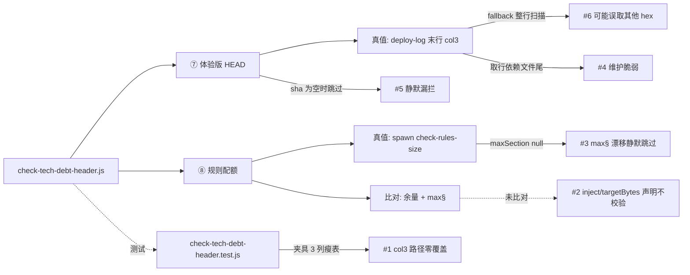

# P3-47 三期扩展 · 双代理交叉技术评审报告

> 评审日期：2026-11-26 ｜ 评审范围：`853d1275..c3bd65ab`（4 commits）｜ 评审方法：双 general-purpose 子代理独立验证 + 主对话交叉裁决
> 技能：`zhaoren-tech-review`（2/2 确认才立项修复，1/1 低置信不修）

## 一句话结论
P3-47 三期门禁（守护配额余量 + 体验版 HEAD）功能正确、真值对齐、防假通过实证成立，**可放行**；评审发现 1 个 P3 测试守护缺口（col3 路径零覆盖）+ 2 个 P4 解析/声明盲区，均不阻断当前，建议选定后修补。

---

## 一、评审范围与方法

**提交清单**（base `853d1275` → HEAD `c3bd65ab`，4 commits）：

| commit | 说明 |
|---|---|
| `358a4b31` | P3-47 盲区实证 + 台账 L79 漂移订正（纯 docs） |
| `27ace072` | 三期门禁扩展 + HANDOFF 快照不回改声明（核心代码+测试+台账） |
| `fb473f64` | 订正 HANDOFF T-23.3 状态拆分 |
| `c3bd65ab` | 回标 HANDOFF 三处「待 push」为「已 push」 |

**diff --stat**：7 files / +133 −15（核心：`check-tech-debt-header.js` +55、`check-tech-debt-header.test.js` +70）。

**方法**：派两位 general-purpose 子代理并行独立验证（A=结构性问题猎手+事实核验，B=定点抽查+等价性核对），输出合同强制「Markdown 结论表 + 判定列，禁止只回代码片段」；主对话对 1/1 项做低成本读码复核，2/2 确认才立项修复。

---

## 二、代理 A 结论汇总（结构性问题猎手 + 事实核验）

| # | 类别 | 声明/问题 | 判定 | 证据（file:line / 实测值） | 置信度 |
|---|---|---|---|---|---|
| A1 | 门禁⑦ | 体验版 HEAD 真值取 deploy-log 末行 col3，漂移→FAIL | 属实 | [check-tech-debt-header.js L102-105](file:///c:/zhaoren/scripts/check-tech-debt-header.js#L102-L105) 提取 / [L168-175](file:///c:/zhaoren/scripts/check-tech-debt-header.js#L168-L175) 比对；真实 gate EXIT=0；deploy-log 末行 col3=966f009b | 高 |
| A2 | 门禁⑧ | 配额余量+max§ spawn check-rules-size，余量=cap−used，漂移/缺行/失败→FAIL | 属实 | [L112-124](file:///c:/zhaoren/scripts/check-tech-debt-header.js#L112-L124) 测量 / [L179-192](file:///c:/zhaoren/scripts/check-tech-debt-header.js#L179-L192) 比对；真实 `check-rules-size` 余量1723/max§46 | 高 |
| A3 | 防假通过 | 5 项三期测试均断言失败（code=1），非假绿 | 属实 | [test L161-218](file:///c:/zhaoren/scripts/check-tech-debt-header.test.js#L161-L218) 每项 `assert.strictEqual(code,1)`；`run()` 返回 `r.status`（超时 null 不误判通过）；实测 14/14 pass | 高 |
| A4 | 真值一致性 | 台账声明（余量1723/max§46/HEAD 966f009b/用例1262）与实测一致 | 属实 | 台账 [L13](file:///c:/zhaoren/docs/tech-debt-inventory-20261123.md#L13)/[L16](file:///c:/zhaoren/docs/tech-debt-inventory-20261123.md#L16)/[L17](file:///c:/zhaoren/docs/tech-debt-inventory-20261123.md#L17) 全部对齐；gate EXIT=0 | 高 |
| A5 | 门禁盲区 | 台账「规则配额」行的 inject 数值（17733B）是否被校验？ | **不符（盲区）** | 独立探针：夹具 inject 改 99999B、余量/max§ 不变 → gate **EXIT=0** 未拦截；[L184-191](file:///c:/zhaoren/scripts/check-tech-debt-header.js#L184-L191) 仅提取余量/max§，inject 只出现在报错文案不参与比对。E-6.66 类「声明写了但不校验」 | 高 |
| A6 | 门禁盲区 | HANDOFF/CHANGELOG/REGISTRY 计数是否被门禁守护？ | 不符（无守护，系设计） | `COUNT-DRIFT` 仅在 gate 逻辑；`check-handoff-coverage` 不引用计数关键词，只校验编号落点；HANDOFF L40 仍写「1256 pass」（现行 1262）未被拦 | 高 |
| A7 | 文档自洽 | 「快照不回改」与台账单一真值源自洽 | 属实（自洽，附风险） | 台账 [L34](file:///c:/zhaoren/docs/tech-debt-inventory-20261123.md#L34) 与 HANDOFF X-19 口径一致 | 中 |
| A8 | 文档自洽 | X-19 登记的 commit 27ace072 是否已 push | 属实 | `git ls-remote origin` → master=c3bd65ab，含 27ace072；`git branch -vv` 无 ahead | 高 |
| A9 | 可靠性 | spawn 超时是否 fail-closed | 属实 | [L118](file:///c:/zhaoren/scripts/check-tech-debt-header.js#L118) timeout 15000 → status null → throw → [TRUTH-MEASURE-FAILED] → [L194-197](file:///c:/zhaoren/scripts/check-tech-debt-header.js#L194-L197) exit1 | 高 |
| A10 | 可靠性 | RULES_SIZE_PATH 环境变量覆盖正确 | 属实 | [L114-116](file:///c:/zhaoren/scripts/check-tech-debt-header.js#L114-L116)；测试 #5 指向不存在文件 → [TRUTH-MEASURE-FAILED] + code=1 | 高 |
| A11 | 可靠性 | deploy-log 异常行（无 SHA/格式变化）处理 | 属实（按设计跳过）+低风险 | 无 SHA → [L172](file:///c:/zhaoren/scripts/check-tech-debt-header.js#L172) 跳过；fallback 取行内首个 hex，列布局剧变时可能误取 | 低 |
| A12 | 测试保真 | 三期 deploy-log 夹具列布局是否与真实一致（覆盖 col3 路径） | **不符（保真度缺口）** | 夹具 [test L47](file:///c:/zhaoren/scripts/check-tech-debt-header.test.js#L47) SHA 在 split[2]，col3(split[3]) 是描述列 → 测试走 fallback，未覆盖真实 col3 提取路径 | 中 |
| A13 | 留痕 | CHANGELOG/REGISTRY/HANDOFF 留痕与代码一致 | 属实 | 三处留痕均与实测（14 测试/1262 用例/gate 绿）一致 | 高 |

---

## 三、代理 B 结论汇总（定点抽查 + 等价性核对）

| # | 抽查项 | 判定 | 证据（file:line / 实测值） | 置信度 |
|---|---|---|---|---|
| B1 | 取最后一条体验版行逻辑 | 属实（功能正确，含脆弱性） | 复现提取 ver=1.6.25 sha=966f009b 与台账一致；gate EXIT=0；但 deploy-log 顶部有 v1.6.32、底部 v1.6.25，靠「文件最后一行」命中 | 高 |
| B2 | col3=split[3] 对应表头「前 commit」列 | 属实 | [deploy-log.md L9](file:///c:/zhaoren/docs/deploy-log.md#L9) 表头；末行 col3 实测含 966f009b | 高 |
| B3 | hex 正则 + fallback 健壮性 | 属实（含潜在风险） | [L104](file:///c:/zhaoren/scripts/check-tech-debt-header.js#L104) col3 优先、回退整行 `l.match`；fallback 扫描整行，说明列含其他 commit SHA 可能误取 | 高 |
| B4 | 测试夹具是否覆盖 col3「优先第 3 列」路径 | **不符（测试缺口）** | 夹具 3 列瘦表，复现 col3(index3) hex match=**NULL**，SHA 全靠 fallback 取得；5 项三期 SHA 测试无一命中 col3 分支 | 高 |
| B5 | RULES_SIZE_PATH 覆盖默认值 | 属实 | [L114-116](file:///c:/zhaoren/scripts/check-tech-debt-header.js#L114-L116) | 高 |
| B6 | 正则匹配真实输出 | 属实 | 真实 `check-rules-size` 输出 → 复现解析 used=17733 cap=19456 maxSection=46 headroom=1723，均非 null | 高 |
| B7 | 测量失败记 [TRUTH-MEASURE-FAILED] 并 exit1 | 属实 | [L122-124](file:///c:/zhaoren/scripts/check-tech-debt-header.js#L122-L124)；测试断言通过 | 高 |
| B8 | HEAD 比对仅 sha 非空时进行（无 SHA 跳过） | 属实（含漏拦权衡） | [L172](file:///c:/zhaoren/scripts/check-tech-debt-header.js#L172)；deploy-log 行格式损坏致 SHA 解析为空时，台账 HEAD 漂移会被静默漏拦 | 中 |
| B9 | 配额行缺行/不可解析处理 | 属实 | 缺行→[MISSING-COUNT] [L181-182](file:///c:/zhaoren/scripts/check-tech-debt-header.js#L181-L182)；不可解析→[UNPARSEABLE] [L191](file:///c:/zhaoren/scripts/check-tech-debt-header.js#L191) | 高 |
| B10 | truth.beta 字符串→对象后版本号比对同步改 .ver | 属实 | 版本比对用 `truth.beta.ver` [L169-170](file:///c:/zhaoren/scripts/check-tech-debt-header.js#L169-L170)，全文件无遗漏字符串式引用；gate EXIT=0 无运行时错误 | 高 |
| B11 | 5 项新增测试夹具与断言等价性 | 属实 | `node --test` → 14/14 pass；5 项三期各断言对应标记 + code===1 | 高 |
| B12 | 「缺少规则配额行」测试是删行还是改行 | 属实（删行） | 用 `.replace(/\| 规则配额 \|.*\n/, '')` 删除整行；断言 [MISSING-COUNT] | 高 |
| B13 | 台账头部真值与实测对齐 | 属实 | [L17](file:///c:/zhaoren/docs/tech-debt-inventory-20261123.md#L17) 余量1723/max§46、[L16](file:///c:/zhaoren/docs/tech-debt-inventory-20261123.md#L16) HEAD 966f009b、[L13](file:///c:/zhaoren/docs/tech-debt-inventory-20261123.md#L13) 1262 用例，全部实测对齐 | 高 |
| B14 | 反向假设：改余量 2110B→exit1→改回→exit0 | 属实（已闭环） | 改 L17 余量→2110B → EXIT=1 报 [COUNT-DRIFT]；立即改回 → EXIT=0；`git diff` 无残留 | 高 |
| B15 | 副作用：verify 重复 spawn 性能 | 属实（可接受） | [package.json L20](file:///c:/zhaoren/package.json#L20) 链内 check-rules-size 独立跑 1 次 + gate 内 spawn 1 次，增量约 1s；只读幂等无副作用 | 高 |
| B16 | RULES_SIZE_PATH 是否在生产 verify 链被意外设置 | 不符（无此风险） | 全仓 grep：仅 gate 逻辑/测试/REGISTRY 出现，无生产脚本/CI 设置 | 高 |
| B17 | maxSection=null 时 max§ 漂移比对是否静默跳过 | **属实（轻微漏拦缺口）** | [L189](file:///c:/zhaoren/scripts/check-tech-debt-header.js#L189) 条件含 `truth.quota.maxSection !== null`：输出有 inject 但缺 max§ 时，台账 max§ 漂移不被拦截（headroom 仍守）；当前真实输出总有 max§，不触发 | 中 |

---

## 四、交叉确认矩阵（主对话裁决）

| # | 缺口/问题 | A | B | 主对话复核 | 交叉结果 | 定级 |
|---|---|---|---|---|---|---|
| 1 | 测试夹具未覆盖 col3 真实路径（5 项 SHA 测试全走 fallback，col3 分支零守护） | 不符(中) | 不符(高) | — | **2/2 确认** | **P3** |
| 2 | 台账「规则配额」行 inject 声明值（17733B）/targetBytes 不被校验（A 探针：改 99999B 仍放行） | 不符(高,探针证伪) | 间接确认 | 读码确认属实 [L185-190](file:///c:/zhaoren/scripts/check-tech-debt-header.js#L185-L190) | 2/2 + 主对话 | P4（设计选择） |
| 3 | `maxSection=null` 时 max§ 漂移被静默跳过（headroom 仍守） | 未提 | 不符(中) | 读码确认属实 [L189](file:///c:/zhaoren/scripts/check-tech-debt-header.js#L189) | 1/1 + 主对话确认 | P4（当前不触发） |
| 4 | deploy-log 取行依赖「文件最后一行」而非版本号最大 | 属实(功能对) | 属实(含脆弱性) | — | 2/2 提及 | P4 维护脆弱 |
| 5 | deploy-log 无 SHA 时 HEAD 校验整段静默跳过 | 属实(按设计,低风险) | 含漏拦权衡(中) | [L172](file:///c:/zhaoren/scripts/check-tech-debt-header.js#L172) 确认 | 2/2 提及 | P4（按设计） |
| 6 | fallback 整行扫描 hex 可能误取说明列其他 commit | 低风险 | 潜在风险 | — | 2/2 提及 | P4 低概率 |
| 7 | HANDOFF/CHANGELOG/REGISTRY 计数无门禁守护（读者误用风险） | 不符(高,设计) | 未重点 | — | 1/1 | P4 / 设计 |

**定级口径**：P2=安全且可利用；P3=可靠性缺陷或守护强度缺口；P4=纯理论边界/当前不触发。本批评审无 P2。

---

## 五、验证者修正

两位子代理初判**均被主对话确认，未被证伪**。唯一视角差异：#5 A 判「按设计低风险」、B 判「中置信漏拦权衡」——非错误，主对话取保守建议（加 WARN 不阻断）。无评审者被证伪项。

---

## 六、确认无问题项（2/2 属实，无需改）

门禁⑦⑧逻辑正确；防假通过 5 项测试均断言 code=1（实测 14/14 全过）；台账真值（余量 1723B / max§ 46 / HEAD 966f009b / 用例 1262）与实测对齐；测量失败 fail-closed（超时 15s→exit1）；`truth.beta` 字符串→对象同步改 `.ver` 无遗漏；缺行→[MISSING-COUNT] / 不可解析→[UNPARSEABLE] 处理正确；反向假设实证闭环（改 2110B→exit1→改回→exit0，无残留）；留痕一致；副作用可接受（verify 多约 1s 重复 spawn）；`RULES_SIZE_PATH` 生产无意外设置。

---

## 七、问题链路图

---

## 八、修复建议与待选选项

**按优先级**：
- **#1（P3，2/2 确认，推荐修）**：测试夹具 deploy-log 改为与真实同构（补「函数」列使 SHA 落在 split[3]），覆盖 col3 分支。低风险。
- **#3（P4，主对话确认，建议同批）**：`maxSection` 解析为 null 时记 `[UNPARSEABLE]`（或 `[TRUTH-MEASURE-FAILED]`）而非静默跳过。低风险。
- **#2（P4）**：可选——四期补 inject/cap 声明校验，或从台账行移除未守的 inject 数值文案避免假安全感。当前不修亦可。
- **#5（P4）**：台账声明了 HEAD 但 `truth.beta.sha` 为空时加 WARN（不阻断）。
- **#4 / #6 / #7**：登记留存负债，不修。

**待用户选定**：
- A = 修 #1 + #3（推荐）
- B = 只修 #1
- C = 修 #1 + #3 + #5
- D = A + #2（移除台账行未守的 inject 文案）
- E = 全部不修，仅登记留存负债

选定后按「最小改动（注释注明评审来源）→ 补/改单测 → `npm run verify:offline` 全绿 → commit → push（含 §44 ls-remote 核对）」流程执行；未选定前不擅自开修。

---

## 九、session-log 六段（§9 存档）

**目标**：对 P3-47 三期扩展（4 commits）做双代理交叉技术评审，确认门禁正确性与防假通过纪律，找出需修补的守护缺口。

**结论**：三期门禁功能正确、真值对齐、防假通过实证成立，可放行；发现 P3 测试缺口 1 项 + P4 解析/声明盲区 2 项，均不阻断，待用户选定修补项。

**证据（命令与实测值）**：
- `git log --oneline 853d1275..HEAD` → 4 commits
- `git diff --stat 853d1275..HEAD` → 7 files / +133 −15
- `node --test scripts/check-tech-debt-header.test.js` → 14/14 pass, 0 fail（A/B 双证实测）
- `node scripts/check-rules-size.js` → inject 17733B/19456B, max§ 46（余量 1723B）
- `node scripts/check-tech-debt-header.js` → `TECH-DEBT-HEADER OK` EXIT=0
- `node scripts/check-test-manifest.js` → 90 文件 / 1262 用例一致
- 反向假设：台账余量改 2110B → EXIT=1 报 [COUNT-DRIFT]；改回 → EXIT=0；无残留（B 实测）
- 探针：inject 改 99999B（余量/max§ 不变）→ gate EXIT=0 未拦截（A 实测，证 #2 盲区）
- 复现：夹具 col3(index3) hex match=NULL，SHA 走 fallback（B 实测，证 #1 缺口）
- `git ls-remote origin master` → c3bd65ab（=HEAD），X-19 commit 27ace072 已推送

**改动与提交**：本评审会话未改任何代码/配置，仅生成此报告文档。被评审的 4 个 commits（358a4b31/27ace072/fb473f64/c3bd65ab）已全部 push 并经 §44 ls-remote 核对。

**未决项**：修复选项 A/B/C/D/E 待用户选定；#2/#4/#5/#6/#7 若选 E 则登记留存负债。

**下次入口**：用户选定修复项后，从本报告第八节对应项开工；若选 E，将 #2/#4/#5/#6/#7 登记入 `docs/tech-debt-inventory-20261123.md` 留存负债区。
