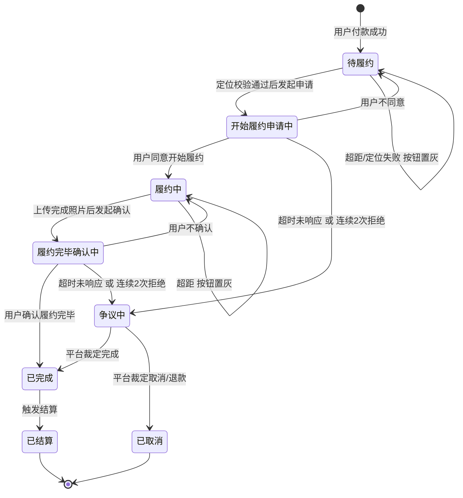
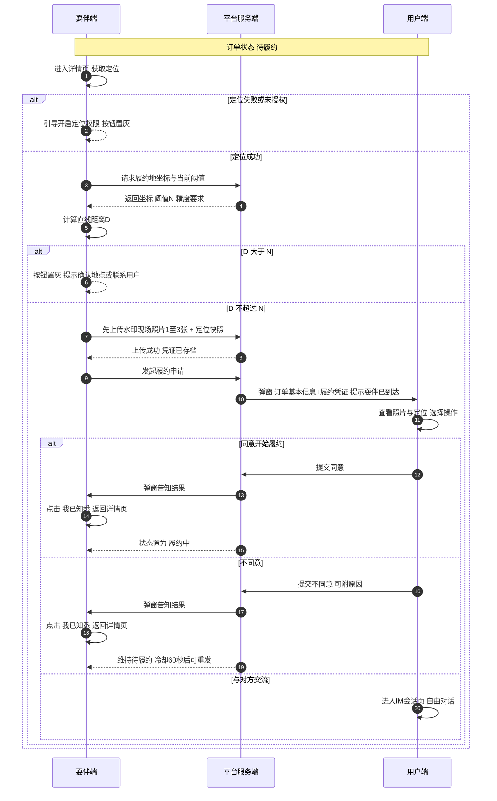
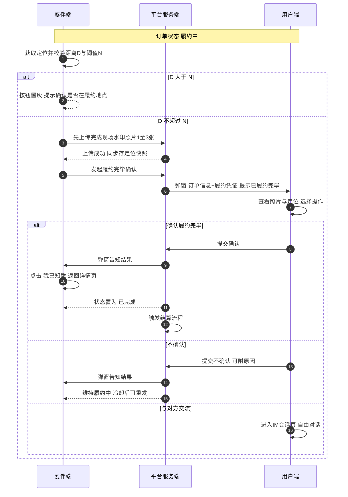
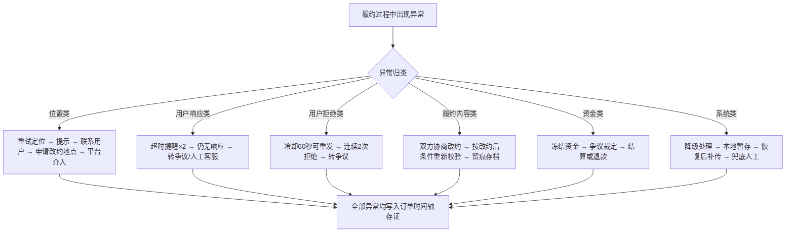

# 线下陪伴 · 履约环节流程规范

> 依据：TRAE 中《线下陪伴项目的履约环节设计》8 条业务描述
> 本文档完成三件事：① 校验矛盾与缺陷 ② 给出规范化表述 ③ 生成流程图与变化场景应对
> 术语约定：**用户** = 需求订单发布者 = 需求方；**耍伴** = 服务者

---

## 一、矛盾与缺陷校验清单

### 1.1 致命矛盾（不改会导致开发返工）

| 编号 | 位置 | 问题描述 | 处理建议 |
|---|---|---|---|
| **C1** | 第 6 条 | 写"耍伴点击 **发起履约申请** 按钮后"，但上下文是履约完毕，应为 **发起履约完毕确认** | 更正按钮名。这是复制粘贴错误，直接决定完成链路的触发点 |
| **C2** | 第 8 条 | 完成照片在用户"确认履约完毕"**之后**才上传 → 用户在**无凭证**情况下确认，确认动作失去意义 | 重排为：耍伴先上传完成照片 → 再发起完毕确认 → 用户**看到照片**后确认 |
| **C3** | 第 2 / 第 5 条 | 按钮名残留：第 1 条已改名"发起履约申请"，这两条仍写"**开始履约**按钮为灰色/可点击" | 全文统一为"发起履约申请" / "发起履约完毕确认" |

### 1.2 逻辑缺陷（不改会导致状态错乱）

| 编号 | 位置 | 问题描述 | 处理建议 |
|---|---|---|---|
| **C4** | 第 2 / 第 5 条 | 按钮状态逻辑**倒置**：描述为"点击 → 校验 → 校验失败按钮变灰"，但按钮已被点击，置灰无意义 | 改为：**按钮状态由实时定位持续决定**（进页面/定位刷新时评估），点击时做二次校验；置灰表示"当前不满足发起条件" |
| **C5** | 第 3 条 vs 第 2 条 | 第 2 条规定超阈值时申请不可继续，第 3 条却写"点击后即向用户弹窗"，**未加位置校验通过的前置条件** | 明确：**仅校验通过才推送用户**；校验失败只提示耍伴，不打扰用户。否则用户会被"人没到"的申请反复骚扰 |
| **C6** | 第 5 条 | 引入"**订单履约完毕**"按钮，但未定义其出现时机，也未说明它与"发起履约完毕确认"是两个按钮还是一个 | 建议**合并为一个**"发起履约完毕确认"（履约中状态直接展示），避免两步操作带来的理解成本 |
| **C7** | 第 3 条重号 | 编号出现两个"3."，全文为 1,2,3,3,4,5,6,7,8 | 重新编号 1–8 |

### 1.3 定义缺失（不改会在上线后爆雷）

| 编号 | 缺失项 | 风险 | 建议补齐 |
|---|---|---|---|
| **C8** | 用户**不响应**时怎么办 | 订单永久卡在"待用户确认" | 设超时（开始 15 分钟 / 完毕 30 分钟）+ 二次提醒 + 转人工 |
| **C9** | 用户点**不同意 / 不确认**后的走向 | 耍伴能否重发？有无上限？ | 允许重发，冷却 60 秒；连续 2 次不同意为异常，转争议流程 |
| **C10** | **结算触发点** | 确认履约完毕后何时放款、未确认时资金状态 | 明确：确认完毕 → T+N 结算；未确认 → 资金冻结并提示 |
| **C11** | **定位异常**处理 | 未授权、定位失败、精度差、地址无法解析 | 见第四节 A 类场景 |
| **C12** | 阈值 **200m 的口径** | 直线距离还是步行距离？坐标系？精度容错？ | 统一为 GCJ-02 坐标系下的**直线距离**；定位精度半径 > 阈值时判为"定位不可信"而非"超距" |
| **C13** | "**四确认 对话界面**"术语不明 | 疑似笔误，无法对齐设计 | 需产品确认，本文暂记为 **IM 会话页** |
| **C14** | 照片**用户侧是否可见** | 第 4/8 条只写"在耍伴订单详情展示" | 完成照片必须**双方可见**，否则用户无法凭凭证确认 |
| **C15** | 照片张数是否可配 | 第 4/8 条写死 3 张，却说文件大小后台可设 | 张数一并纳入后台配置（1–3 张） |
| **C16** | 角色称谓不统一 | 需求订单发布者 / 用户 / 需求方 三种叫法 | 统一为"用户"、"耍伴" |

---

## 二、规范化业务表述

### 2.1 订单状态机

| 状态 | 含义 | 耍伴端主按钮 | 用户端动作 |
|---|---|---|---|
| `待履约` | 已支付，未开始 | 发起履约申请 | — |
| `开始履约申请中` | 已发起，待用户确认 | 等待中（按钮不可用） | 同意 / 不同意 / 交流 |
| `履约中` | 用户已同意开始 | 发起履约完毕确认 | — |
| `履约完毕确认中` | 已发起完毕确认 | 等待中（按钮不可用） | 确认 / 不确认 / 交流 |
| `已完成` | 用户已确认完毕 | — | — |
| `已结算` | 资金已结算 | — | — |
| `争议中` | 异常转人工 | 按客服指引 | 按客服指引 |

### 2.2 开始履约流程（规范版）

1. 用户付款成功后，耍伴订单详情页原「开始履约」按钮改名为「**发起履约申请**」。
2. 进入订单详情页及定位刷新时，系统持续校验耍伴实时位置与订单履约地坐标的直线距离 `D`，与后台阈值 `N`（默认 200 米）比对：
   - `D ≤ N` → 按钮**可点击**；
   - `D > N` → 按钮**置灰**，并提示"请确认是否到达履约地点，或联系用户确认地点"。
3. `D ≤ N` 时耍伴点击「发起履约申请」，**先上传现场照片**（**带水印**，1–3 张）+ 提交**定位快照**（坐标、精度、服务端时间戳）至平台存档；**两者都成功后才发起申请**，否则停留 `待履约`、不推送通知（凭证前置，2026-10-15 变更）。
4. 系统向用户推送弹窗，展示订单基本信息**及履约凭证（现场照片、定位快照、时间）**，提示"耍伴已到达指定履约点，准备履约"，并提供三个操作：**同意开始履约** / **不同意** / **与对方交流**（进入 IM 会话页自由对话）。
5. 用户作出选择后，系统即时弹窗告知耍伴；弹窗含「**我已知悉**」按钮，点击后弹窗关闭，返回订单详情页。
6. 用户点击「同意开始履约」后，订单置为 `履约中`；现场照片已在第 3 条随申请上传存档，**双方**订单详情页此时即可查看（用户确认前已可见，供其凭凭证确认）。
7. 用户点击「不同意」：订单维持 `待履约`，允许耍伴**冷却 60 秒后重新发起**；连续 2 次被拒绝转为 `争议中`。

### 2.3 履约完毕流程（规范版 · 已修正顺序）

1. 订单进入 `履约中` 后，耍伴订单详情页展示「**发起履约完毕确认**」按钮（原"订单履约完毕"与之合并）。
2. 同 2.2 第 2 条规则，按钮状态由实时距离校验持续决定。
3. `D ≤ N` 时耍伴点击按钮，**先完成现场照片上传**（带水印，1–3 张）+ 定位快照存档，**再**发起完毕确认请求。
4. 系统向用户推送弹窗，展示订单基本信息**及履约凭证（现场照片、定位快照、时间）**，提示"耍伴已履约完毕"，并提供三个操作：**确认履约完毕** / **不确认** / **与对方交流**。
5. 用户作出选择后，系统即时弹窗告知耍伴，弹窗含「**我已知悉**」按钮，点击后返回订单详情页。
6. 用户点击「确认履约完毕」→ 订单置为 `已完成`，触发结算流程。
7. 用户点击「不确认」→ 订单维持 `履约中`，允许耍伴冷却后重新发起；连续 2 次被拒绝转为 `争议中`。

### 2.4 水印与存证规范

| 项 | 规范 |
|---|---|
| 水印内容 | 服务端时间戳（**禁止用客户端时间**）、地点文字、订单号、角色标识（耍伴） |
| 照片数量 | 1–3 张，后台可配 |
| 单张大小 | 后台可配，建议默认 ≤ 5MB，超限前端压缩后上传 |
| 存证字段 | `order_id`、`role`、`lat/lng`（GCJ-02）、`accuracy`、`server_time`、`photo_urls`、`threshold_used` |
| 可见范围 | 双方订单详情 + 平台后台；纠纷时作为取证依据 |

---

## 三、流程图

### 图 1 · 订单履约状态机

### 图 2 · 开始履约子流程

### 图 3 · 履约完毕子流程（已修正顺序）

### 图 4 · 变化场景应对主流程

---

## 四、变化场景枚举与应对

### A 类 · 位置与定位

| 编号 | 场景 | 影响 | 应对策略 | 需拍板 |
|---|---|---|---|---|
| A1 | 用户/耍伴未授权定位权限 | 无法校验，按钮永远置灰 | 首次进入引导授权；拒绝则提示"无法发起"，提供联系客服入口 | |
| A2 | 定位失败或超时（地下车库、弱网） | 校验无结果 | 30 秒重试最多 3 次；仍失败判为"定位不可信"，提示移动至开阔地 | |
| A3 | 定位精度差（精度半径 50–500m） | 可能误判超距或误判通过 | 精度半径 > 阈值时判为"定位不可信"（**不是超距**），提示重试；精度半径 > 100m 时即使通过也标记为"低可信度"留痕 | ✅ 精度阈值 |
| A4 | 履约地址为文本，无法解析坐标 | 无比对基准 | 下单时强制地理编码并保存坐标；解析失败禁止发布订单 | |
| A5 | 用户临时变更履约地点 | 原坐标失效 | 提供"改约地点"入口，双方确认后更新坐标，**保留旧坐标留痕** | |
| A6 | 履约过程本身是移动的（陪逛、接送） | 完毕时位置天然偏离 | 完毕校验改用"**履约地或用户确认地**"为基准，或允许用户在 IM 中确认位置 | ✅ 移动型订单是否豁免 |
| A7 | 疑似作弊（模拟定位、多设备、异地打卡） | 刷单风险 | 检测模拟定位 API、设备指纹、IP 与坐标城市一致性；命中标记风控，不阻断但留痕 | |
| A8 | 坐标系不一致（WGS-84 / GCJ-02 / BD-09） | 距离偏差可达数百米 | 全链路统一 **GCJ-02**（腾讯系原生），入库前强制转换 | |

### B 类 · 用户侧响应

| 编号 | 场景 | 影响 | 应对策略 | 需拍板 |
|---|---|---|---|---|
| B1 | 用户长时间不响应 | 订单卡死，耍伴空等 | 开始履约超时 **15 分钟**、完毕确认超时 **30 分钟**；各推送 2 次提醒；仍无响应转 `争议中` + 人工外呼 | ✅ 是否开启"超时自动同意" |
| B2 | 用户点击不同意 / 不确认 | 履约中断 | 允许耍伴冷却 60 秒后重发；连续 2 次拒绝转争议 | |
| B3 | 用户离线 / 未订阅消息 | 收不到弹窗 | 订阅消息 + 短信 + 站内信三通道；订阅额度不足时降级短信 | |
| B4 | 用户误操作 | 错误拒绝 | 拒绝后 5 分钟内允许"撤销"一次 | |
| B5 | 用户完全失联 | 耍伴到场无人确认 | 超 30 分钟转人工客服；客服可凭存证（定位+照片）裁定 | |
| B6 | 用户中途取消订单 | 履约中订单被取消 | 已开始履约的取消需走退款协商，按履约比例结算 | ✅ 履约中取消规则 |

### C 类 · 耍伴侧行为

| 编号 | 场景 | 影响 | 应对策略 | 需拍板 |
|---|---|---|---|---|
| C1 | 耍伴重复点击 / 并发提交 | 重复申请、重复弹窗骚扰用户 | 按钮防抖 + 服务端幂等（按 `order_id + 阶段 + 时间窗` 去重） | |
| C2 | 照片上传失败（网络/超限） | 流程中断 | 本地暂存 + 断点续传；超限前端压缩；水印生成失败禁止上传 | |
| C3 | 照片数量或大小超限 | 提交被拒 | 前端预校验并明确提示；张数纳入后台配置 | |
| C4 | 耍伴中途放弃 / 无法到场 | 订单悬空 | 提供"放弃履约"入口，通知用户并走退款 | |
| C5 | 耍伴设备故障（换机、没电） | 无法打卡 | 允许客服凭佐证人工核验；同一订单换设备需风控标记 | |

### D 类 · 履约内容与时间

| 编号 | 场景 | 影响 | 应对策略 | 需拍板 |
|---|---|---|---|---|
| D1 | 提前结束 / 服务时长不足 | 用户不愿确认完毕 | 完毕确认弹窗展示约定时长与实际时长；争议按实际时长比例结算 | ✅ 短时履约结算规则 |
| D2 | 服务超时延长（加时） | 超出订单约定 | 提供"申请加时"，双方确认后生成追加订单 | ✅ 加时计费 |
| D3 | 部分履约 / 服务内容变更 | 完成标准模糊 | IM 协商 + 改约留痕；完毕确认以双方最新约定为准 | |
| D4 | 提前到达 / 迟到 | 与约定时间不符 | 时间轴记录实际到达时间；迟到纳入服务评价 | |
| D5 | 非本人到场（代履约） | 身份风险 | 拍照环节可叠加人脸核身；命中标记风控 | ✅ 是否强制核身 |

### E 类 · 订单与资金

| 编号 | 场景 | 影响 | 应对策略 | 需拍板 |
|---|---|---|---|---|
| E1 | 用户不确认完毕 | 资金长期冻结 | 超时转争议；争议期内资金冻结并提示双方；客服裁定后结算或退款 | ✅ 冻结期限 |
| E2 | 结算失败 | 耍伴未收到款 | 结算失败自动重试 + 告警；人工兜底打款 | |
| E3 | 履约中用户申请退款 | 资金与状态冲突 | 已开始履约的退款需双方协商或客服裁定，禁止单方全额退 | ✅ 履约中退款规则 |
| E4 | 争议与平台介入 | 需裁定 | 凭存证（定位快照、水印照片、IM 记录、时间轴）裁定 | ✅ 裁定 SLA |
| E5 | 加时费 / 额外费用 | 超出原订单金额 | 走追加订单或线下协商，平台不代收未约定费用 | |

### F 类 · 系统与合规

| 编号 | 场景 | 影响 | 应对策略 | 需拍板 |
|---|---|---|---|---|
| F1 | 订阅消息额度耗尽 / 推送失败 | 用户收不到确认请求 | 降级短信；推送失败重试 3 次并在时间轴标注"未触达" | |
| F2 | 后台阈值变更（200m 调整） | 存量订单适用哪个阈值 | **快照制**：发起时读取的阈值写入订单存证，存量订单不受后续调整影响 | |
| F3 | 客户端时间被篡改 | 水印时间不可信 | 水印时间一律取**服务端时间戳** | |
| F4 | 照片含人脸 / 隐私信息 | 合规风险 | 照片仅双方与平台可见；隐私政策明示；存储加密 + 定期清理 | ✅ 留存期限 |
| F5 | 纠纷取证 | 证据不足 | 全链路时间轴 + 定位快照 + 水印照片 + IM 记录统一归档 | |
| F6 | 多端同时操作 | 状态冲突 | 服务端状态机强校验，非法流转直接拒绝并提示刷新 | |

---

## 五、建议默认参数（供后台配置参考）

| 参数 | 默认值 | 说明 |
|---|---|---|
| 距离阈值 | 200 米 | 直线距离，GCJ-02 |
| 定位精度要求 | ≤ 50 米 | 超过则判为"定位不可信" |
| 开始履约响应超时 | 15 分钟 | 提醒 2 次后转争议 |
| 完毕确认响应超时 | 30 分钟 | 提醒 2 次后转争议 |
| 重新发起冷却 | 60 秒 | 防骚扰 |
| 连续拒绝上限 | 2 次 | 超出转争议 |
| 照片张数 | 1–3 张 | 开始与完毕各一组 |
| 单张大小上限 | 5 MB | 超限前端压缩 |
| 结算触发 | 用户确认完毕后 T+N | 需与支付侧对齐 |

---

## 六、待产品拍板清单

1. **C2 顺序调整**是否接受（完成照片前置到用户确认之前）
2. **C6** 是否合并"订单履约完毕"与"发起履约完毕确认"为一个按钮
3. **C13** "四确认 对话界面"的确切含义
4. **A6** 移动型订单（陪逛、接送）是否豁免完毕位置校验
5. **B1** 是否开启"超时自动同意"（体验更好但有资金风险）
6. **B6 / E3** 履约中与已开始履约后的取消退款规则
7. **D5** 是否强制人脸核身
8. **E1 / F4** 资金冻结期限与照片留存期限

---

## 七、开发落地提示

- **状态流转强校验**：所有阶段切换在服务端用状态机拦截非法流转，前端按钮只是展示层
- **幂等设计**：发起申请、照片上传、确认动作全部按 `order_id + 阶段 + 时间窗` 去重
- **阈值快照**：发起瞬间把阈值写入订单记录，避免后台改配置引发争议
- **时间取服务端**：水印、时间轴、超时计算一律用服务端时间
- **存证先行**：定位快照与照片先落库再推消息，避免"先通知后丢证"
